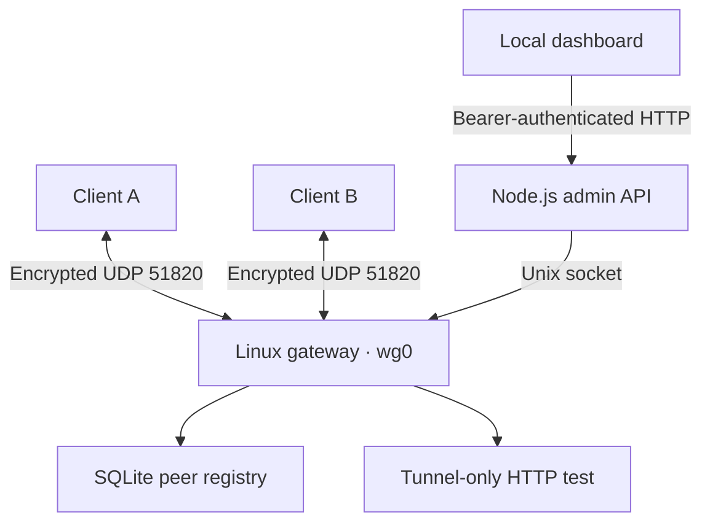

# WireGuard VPN Lab

Run your own private IPv4 network for a Mac, an iPhone, a Windows PC, or other devices with a WireGuard client. The web dashboard enrolls devices, exports their WireGuard profiles, displays handshake and traffic counters, and revokes access.

## How it works



The gateway assigns each device one address in `10.71.0.0/24`. WireGuard accepts that address as a packet source only from the peer with the corresponding public key. The gateway forwards traffic between enrolled devices through `wg0`. Its firewall drops other forwarded traffic. The client profile routes only the VPN subnet through the tunnel, so internet traffic and DNS keep using the device’s usual connection.

| Component | Source | Role |
| --- | --- | --- |
| Web frontend | [public/](public/) | Unlock, enroll, download profiles, inspect traffic, revoke |
| Admin API | [src/admin.mjs](src/admin.mjs) | Serve the dashboard and authenticate management requests |
| Gateway | [src/gateway.mjs](src/gateway.mjs), [src/wireguard.mjs](src/wireguard.mjs) | Configure Linux WireGuard, nftables, and the tunnel test |
| Peer registry | [src/store.mjs](src/store.mjs) | Allocate IP addresses and persist peer records |
| Runtime | [compose.yaml](compose.yaml), [Dockerfile](Dockerfile) | Build and isolate the two services |

## Start the VPN

Use a Linux machine or VM with kernel support for WireGuard and nftables, rootful Docker Engine 28 or newer, and the Docker Compose v2 plugin. The gateway needs `NET_ADMIN` in its own container network namespace. If the modules are available but unloaded, load them on the **Linux host** with `sudo modprobe wireguard` and `sudo modprobe nf_tables`.

1. Clone the repo and enter the project directory.

   ```bash
   git clone https://github.com/snafshar/-Linux-IT-.git
   cd ./-Linux-IT-/projects/wireguard-vpn
   ```

2. Set the endpoint to an IPv4 address or DNS name reachable from your clients. For devices on your home Wi-Fi, use the Linux host’s LAN address. For remote devices, use the public address or DNS name and allow or forward **UDP 51820** to the host. The endpoint can include an external UDP port if the router maps it to `51820` on the Linux host.

   With Node.js 24.16 or newer, generate the settings file and a random admin token. Replace the sample IP with your server’s address.

   ```bash
   npm run setup -- 192.168.1.50
   ```

   On a Docker-only host, run `cp .env.example .env` and `chmod 600 .env`. Edit `VPN_ENDPOINT` and set `VPN_ADMIN_TOKEN` to the output of `openssl rand -hex 32`. If `10.71.0.0/24` overlaps a client LAN, host route, or Docker network, set `VPN_SUBNET` to an unused private IPv4 `/24` before the first start.

3. Build and start both services.

   ```bash
   docker compose up -d --build --wait
   docker compose ps
   ```

4. Open [the dashboard](http://127.0.0.1:8787/) on the Linux host. If you administer it from your Mac or another computer, open an SSH forward first, then visit the same URL locally.

   ```bash
   ssh -N -L 127.0.0.1:8787:127.0.0.1:8787 user@vpn.example.com
   ```

   Read your admin token on the Linux host and paste it into the dashboard.

   ```bash
   sed -n 's/^VPN_ADMIN_TOKEN=//p' .env
   ```

## Connect a Mac or iPhone

1. Add a device in the dashboard and download its `.conf` profile. Enroll each physical device separately.
2. Import the file into the [official WireGuard client](https://www.wireguard.com/install/) and activate the tunnel. On iPhone you can transfer the profile privately with AirDrop and import it from Files.
3. From the enrolled device, open `http://10.71.0.1:8080/` or use `curl -fsS http://10.71.0.1:8080/` on a computer. The dashboard shows the correct test URL if you chose a different subnet.
4. Refresh the dashboard to see the WireGuard handshake and traffic. To test device-to-device traffic, access a service listening on the second device’s assigned VPN address and allow it in that device’s firewall.
5. To remove a device, select **Revoke**. The gateway removes its public key and stops accepting the old profile.

## Management API

Send `Authorization: Bearer <VPN_ADMIN_TOKEN>` to `http://127.0.0.1:8787`. Use `Content-Type: application/json` for enrollment.

| Method and path | Input | Success |
| --- | --- | --- |
| `GET /api/network` | | `200` with endpoint, subnet, gateway, test URL, capacity and peer statistics |
| `POST /api/peers` | `{"name":"MacBook"}` | `201` with the peer record and a one-time `profile` string |
| `DELETE /api/peers/{id}` | Peer ID from the list or enrollment response | `204` |

The gateway has one persistent state volume for its private key and SQLite database. The database stores peer names, addresses, public keys, and creation times. Client private keys are delivered in the enrollment response and are never stored in SQLite. If a profile is lost or an enrollment request times out, refresh the peer list, revoke the existing record, and enroll the device again. Keep the downloaded profiles and `.env` private.

The management port is published on host loopback. Only the gateway container receives `NET_ADMIN`. The containers use separate networks and share a Unix socket for control requests. Keep the dashboard on loopback and use the SSH forward for remote administration. Tunnel traffic between clients is decrypted and re-encrypted at the gateway, so the Linux host administrator is trusted.

## Tests and operation

| Command | What it does |
| --- | --- |
| `npm test` | Exercises API authorization, peer lifecycle, SQLite persistence and rollback with a test gateway adapter |
| `npm run test:tunnel` | Starts an isolated Compose project on a Linux Docker host and verifies real WireGuard traffic between two peers, recovery after a gateway restart, and revocation |
| `docker compose logs -f gateway` | Shows gateway startup and errors |
| `docker compose down` | Stops both services and preserves the server key and peer registry |

Run the tunnel test on a host with ports `8787/tcp` and `51820/udp` free. It creates disposable containers and volumes and removes them when it finishes.

If the dashboard loads but a device has no handshake, check that the profile’s endpoint is reachable and that the router and host allow the published UDP port. If a handshake succeeds but a service is unreachable, check the client routes, VPN subnet overlap, and the destination device’s firewall.

Back up the state volume while the stack is stopped and protect the backup as a private key. Preserve it when rebuilding images or moving the service to a new host. Changing the VPN subnet requires a fresh state volume and new client profiles.

## References

- [WireGuard quick start](https://www.wireguard.com/quickstart/)
- [WireGuard cryptokey routing](https://www.wireguard.com/#cryptokey-routing)
- [Docker port publishing](https://docs.docker.com/engine/network/port-publishing/)
